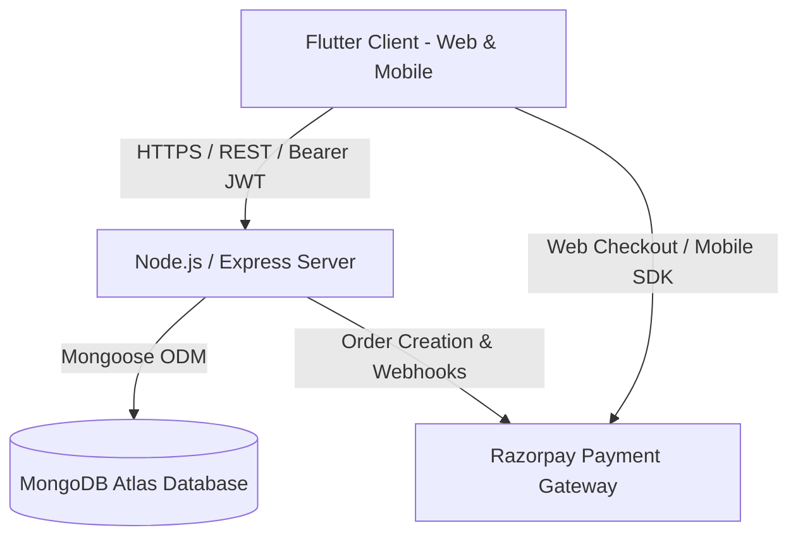
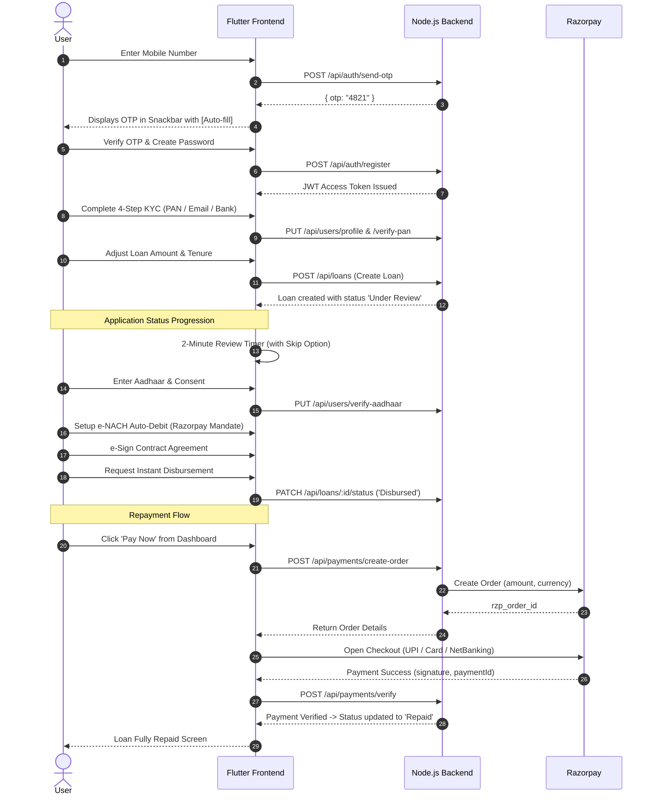

# CreditSea — Digital Lending & Loan Management Platform

[](https://flutter.dev)
[](https://nodejs.org)
[](https://expressjs.com)
[](https://www.mongodb.com)
[](https://razorpay.com)
[](LICENSE)

An enterprise-grade, full-stack digital lending application featuring end-to-end loan application workflows, automated e-KYC verification, real-time EMI calculation, 6-stage lifecycle tracking, and Razorpay automated repayment integration.

---

## 🚀 Live Deployments & Project Deliverables

| Deliverable | Platform / Type | Link / Path | Status |
| :--- | :--- | :--- | :---: |
| 🌐 **Live Backend API** | Render Cloud | [https://creditsea-loan-muzs.onrender.com](https://creditsea-loan-muzs.onrender.com) | 🟢 Live |
| 📡 **API Base URL** | REST Endpoints | [https://creditsea-loan-muzs.onrender.com/api](https://creditsea-loan-muzs.onrender.com/api) | 🟢 Active |
| 🎬 **App Demo Video** | Video Walkthrough | [Watch CreditSea Demo on Google Drive](https://drive.google.com/file/d/1uwyzQ6oX_Wnbe0c_YqpCB92FBN3_dYel/view?usp=sharing) | 📺 Stream |
| 📱 **Downloadable Android APK** | Release Build (ARM64 / v7a) | [Download app-release.apk (Google Drive)](https://drive.google.com/file/d/1PBdHqyyoBKshxjMCQqCTTY9tzPZfbqV9/view?usp=sharing) *(54 MB)* | 📦 Ready to Install |

---

### 📱 Android APK Package Details

| Specification | Value |
| :--- | :--- |
| **Package Name** | `com.example.creditsea_app` |
| **Download Link** | [Google Drive APK Download](https://drive.google.com/file/d/1PBdHqyyoBKshxjMCQqCTTY9tzPZfbqV9/view?usp=sharing) |
| **File Size** | **54.2 MB** |
| **Build Mode** | Release (Optimized, Tree-shaken, Minified) |
| **Connected API Endpoint** | `https://creditsea-loan-muzs.onrender.com/api` |
| **Min Android Version** | Android 6.0 (API Level 23) |
| **Target Android Version** | Android 14 (API Level 34) |

#### How to Install the APK on Your Android Device:
1. Download or transfer `app-release.apk` to your phone.
2. Tap the APK file in your file manager or browser downloads.
3. If prompted, toggle **"Allow installation from unknown sources"** in device settings.
4. Tap **Install** and open the CreditSea app.

---

## 📑 Table of Contents

- [Key Features](#-key-features)
- [Architecture & Tech Stack](#-architecture--tech-stack)
- [Project Structure](#-project-structure)
- [User Journey & Loan Lifecycle](#-user-journey--loan-lifecycle)
- [API Documentation](#-api-documentation)
- [Local Setup & Installation](#-local-setup--installation)
- [Environment Configuration](#-environment-configuration)
- [Testing & Quality Assurance](#-testing--quality-assurance)
- [Deployment Guide](#-deployment-guide)

---

## ✨ Key Features

### 1. Authentication & Security
- **OTP-Based Mobile Verification**: 4-digit SMS OTP generation with real-time in-app notification snackbar and one-tap **Auto-fill** action.
- **Secure Credentials**: Passwords encrypted with salted `bcrypt`, stateless JWT authentication supporting both HTTP-only cookies and `Bearer` authorization headers.
- **Form UX**: Zero-overflow responsive bottom sheet with adaptive flex ratios for compact and large mobile screens alike.

### 2. Multi-Step Digital KYC & Profile Completion
- **Personal & Contact Info**: Name, DOB, gender, and simulated email OTP verification.
- **Income & Employment**: Employment type (Salaried / Self-Employed), employer name, and monthly take-home salary.
- **Identity & Compliance**: Real-time PAN format validation (`ABCDE1234F`) and Aadhaar card verification with 12-digit masking and UIDAI consent modal.
- **Bank Account Setup**: Account number, IFSC code, and automated account validation.

### 3. Interactive Loan Calculator & Offer System
- **Real-Time EMI Calculator**: Dynamic sliders for loan amounts (₹1,000 to ₹10,00,000) and tenure (1 to 60 months) with live breakdown of monthly EMI, total interest, and total payable.
- **Personalized Loan Offers**: Clear display of approved amounts, processing fees, interest rates, and loan terms with an **"Extend Offer"** flow that preserves user choices when recalculating.

### 4. 6-Stage Loan Tracking Lifecycle
1. **Application Submitted**: Automatic confirmation upon applying.
2. **Under Review**: 2-minute demo timer with live countdown badge, progress bar, and an instant **"Continue (Skip Wait)"** option for quick testing.
3. **E-KYC Verification**: Aadhaar input modal with masked preview (`XXXX XXXX 1234`), UIDAI legal declaration, and demo OTP validation.
4. **E-NACH Auto-Debit**: Razorpay e-Mandate auto-debit setup for recurring EMI deductions on the scheduled due date.
5. **E-Sign Loan Agreement**: Comprehensive loan summary, digital contract excerpt, borrower declaration, and e-signature consent.
6. **Instant Disbursement**: Immediate IMPS bank transfer simulation with transaction reference IDs and automated status transition to `Disbursed`.

### 5. Repayment & Portfolio Dashboard
- **Branded Dashboard**: Clean header featuring official CreditSea branding, active loan overviews, and quick actions.
- **Razorpay Integration**: Seamless repayment flow with instant checkout supporting UPI (Google Pay, PhonePe, Paytm), NetBanking, and Cards.
- **Hybrid Platform Compatibility**: Native mobile SDK on Android/iOS and custom `checkout.js` integration for Flutter Web.
- **Auto-Settlement**: On repayment completion, loan balance updates to ₹0, all stages reflect as completed, and the app prompts for new loan applications.

---

## 🛠 Architecture & Tech Stack



### Frontend (Mobile & Web)
- **Framework**: [Flutter 3.x](https://flutter.dev) (Dart 3.x)
- **State Management & Routing**: [GetX](https://pub.dev/packages/get)
- **HTTP Client**: [Dio](https://pub.dev/packages/dio) with custom logging and Bearer token interceptors
- **Persistence**: [SharedPreferences](https://pub.dev/packages/shared_preferences) for local state and offline loan progress
- **UI Components**: Custom reusable design system (inputs, buttons, headers, bottom sheets, sliders)
- **Icons & Graphics**: `flutter_svg` with vector illustrations

### Backend (REST API)
- **Runtime**: [Node.js](https://nodejs.org) (ES Modules)
- **Framework**: [Express 5.x](https://expressjs.com)
- **Database**: [MongoDB Atlas](https://www.mongodb.com/atlas) with [Mongoose](https://mongoosejs.com)
- **Authentication**: `jsonwebtoken` (JWT) + `bcryptjs`
- **Payments**: `razorpay` official Node.js SDK + HMAC-SHA256 signature verification
- **CORS & Security**: Configurable `cors` middleware, `cookie-parser`, and sanitized input validation

---

## 📁 Project Structure

```text
Creditsea-assignment/
├── backend/
│   ├── config/
│   │   ├── db.js                     # MongoDB connection handler
│   │   └── razorpay.js               # Razorpay client instance
│   ├── controllers/
│   │   ├── authController.js         # Mobile OTP, Registration, Login
│   │   ├── userController.js         # Profile, PAN, Aadhaar, Email KYC
│   │   ├── loanController.js         # Loan creation, listing, status lifecycle
│   │   └── paymentController.js      # Razorpay order generation & verification
│   ├── middleware/
│   │   └── authMiddleware.js         # JWT cookie & Bearer token verification
│   ├── models/
│   │   ├── otpModel.js               # Ephemeral OTP model with TTL index
│   │   ├── userModel.js              # User schema with embedded KYC details
│   │   ├── loanModel.js              # Loan schema with EMI and status tracking
│   │   └── paymentModel.js           # Transaction & repayment audit records
│   ├── routes/
│   │   ├── authRoutes.js             # /api/auth
│   │   ├── userRoutes.js             # /api/users
│   │   ├── loanRoutes.js             # /api/loans
│   │   └── paymentRoutes.js          # /api/payments
│   ├── utils/
│   │   ├── generateToken.js          # Access & OTP token generators
│   │   ├── loanEligibility.js        # Salary-based credit algorithm
│   │   └── otpGenerator.js           # Secure numeric code generator
│   ├── index.js                      # Express app entry & route registration
│   ├── package.json                  # Scripts & dependencies
│   └── .env.example                  # Environment configuration template
│
└── frontend/
    ├── lib/
    │   ├── app/
    │   │   ├── app.dart              # GetMaterialApp configuration & theme
    │   │   ├── bindings/             # Global initial bindings
    │   │   └── routes/               # AppRoutes & AppPages declarations
    │   ├── core/
    │   │   ├── components/           # Reusable UI widgets (PhoneInput, CustomButton)
    │   │   ├── network/              # ApiClient (Dio) with Web/Native adapters
    │   │   ├── services/             # StorageService (local progress persistence)
    │   │   ├── theme/                # AppColors & Typography definitions
    │   │   └── widgets/              # PromoHeader, RegistrationProgress
    │   ├── data/
    │   │   ├── models/               # UserModel, LoanModel, PaymentModel
    │   │   └── repositories/         # Auth, User, Loan, and Payment repositories
    │   ├── modules/
    │   │   ├── authentication/       # Signup, Signin, OTP, Password views & controllers
    │   │   ├── profile/              # KYC verification (PAN, Personal, Bank)
    │   │   ├── loan_calculator/      # Dynamic EMI Calculator & loan request
    │   │   ├── loan_application/     # Loan Offer review & terms
    │   │   ├── loan_tracking/        # 6-step status progression & interactive sheets
    │   │   ├── dashboard/            # Overview, loan cards, quick actions
    │   │   ├── payment/              # Razorpay mobile & web payment handlers
    │   │   └── splash/               # Animated splash screen
    │   └── main.dart                 # Application entry point
    ├── web/
    │   └── index.html                # Razorpay checkout.js web bridge
    └── pubspec.yaml                  # Flutter package dependencies
```

---

## 🔄 User Journey & Loan Lifecycle



---

## 📡 API Documentation

> 🌐 **Live Production Base URL:** `https://creditsea-loan-muzs.onrender.com/api`  
> 💻 **Local Development Base URL:** `http://localhost:8000/api`

### Authentication (`/api/auth`)
| Method | Endpoint | Description | Protected |
| :--- | :--- | :--- | :---: |
| `POST` | `/send-otp` | Generate and dispatch 4-digit mobile OTP | No |
| `POST` | `/verify-otp` | Validate entered OTP against stored hash | No |
| `POST` | `/register` | Complete account registration with password | No |
| `POST` | `/login` | Authenticate with mobile number & password | No |
| `POST` | `/logout` | Clear session cookie and invalidate token | Yes |

### User & KYC (`/api/users`)
| Method | Endpoint | Description | Protected |
| :--- | :--- | :--- | :---: |
| `GET` | `/profile` | Fetch authenticated user profile & KYC status | Yes |
| `PUT` | `/profile` | Update personal and employment details | Yes |
| `PUT` | `/verify-email` | Validate email address with OTP | Yes |
| `POST` | `/verify-pan` | Validate PAN number and link to borrower | Yes |
| `PUT` | `/verify-aadhaar` | Record Aadhaar e-KYC compliance & consent | Yes |

### Loan Management (`/api/loans`)
| Method | Endpoint | Description | Protected |
| :--- | :--- | :--- | :---: |
| `POST` | `/` | Apply for a new loan with amount & tenure | Yes |
| `GET` | `/` | Retrieve user loan history | Yes |
| `GET` | `/active` | Fetch current active loan for dashboard | Yes |
| `GET` | `/:id` | Fetch specific loan details | Yes |
| `PATCH`| `/:id/status` | Update loan stage (`Approved`, `Disbursed`, `Repaid`) | Yes |

### Payments & Repayment (`/api/payments`)
| Method | Endpoint | Description | Protected |
| :--- | :--- | :--- | :---: |
| `POST` | `/create-order` | Generate Razorpay order ID | Yes |
| `POST` | `/verify` | Verify payment HMAC signature & settle balance | Yes |
| `GET` | `/history` | Fetch transaction payment receipts | Yes |

---

## 💻 Local Setup & Installation

### Prerequisites
- [Flutter SDK](https://docs.flutter.dev/get-started/install) (`v3.19+`)
- [Node.js](https://nodejs.org) (`v18+`) and `npm`
- [MongoDB Atlas](https://www.mongodb.com/atlas) connection string (or local MongoDB)
- [Razorpay Test Account](https://dashboard.razorpay.com) for API keys

---

### 1. Backend Setup

```bash
# Navigate to backend directory
cd backend

# Install dependencies
npm install

# Create environment configuration file
cp .env.example .env

# Edit .env with your credentials (MongoDB URI, JWT Secrets, Razorpay Keys)
nano .env

# Start server in development mode
npm run dev
# Or for production:
npm start
```
The server will run on `http://localhost:8000`.

---

### 2. Frontend Setup

```bash
# Navigate to frontend directory
cd frontend

# Install Flutter packages
flutter pub get

# Run code analysis
flutter analyze

# Run unit and widget tests
flutter test

# Launch on Chrome (Web)
flutter run -d chrome

# Launch on Connected Android Device or Emulator
flutter run -d android
```

---

## ⚙️ Environment Configuration

### Backend (`backend/.env`)

```env
PORT=8000
MONGODB_URI=mongodb+srv://<username>:<password>@cluster0.mongodb.net/creditsea
JWT_SECRET=your_jwt_secret_key_here
JWT_OTP_SECRET=your_otp_secret_key_here
RAZORPAY_KEY_ID=rzp_test_YourKeyIdHere
RAZORPAY_KEY_SECRET=your_razorpay_secret_here
ALLOWED_ORIGINS=http://localhost:3000,http://localhost:8000
```

> [!CAUTION]
> Never commit your `.env` file containing live credentials to source control. It is ignored by default in `.gitignore`.

---

## 🧪 Testing & Quality Assurance

### Frontend
- **Static Analysis**: Verified with strict Flutter linter rules (`flutter analyze`) with **0 issues found**.
- **Widget & Unit Tests**: Automated tests verify widget rendering, splash transitions, and clean controller teardown.
```bash
cd frontend && flutter test
```

### Backend
- **Syntax Validation**: Checked with `node -c` on all route handlers and controllers.
- **HMAC Signature Testing**: Validated Razorpay SHA-256 signature algorithm against live Razorpay webhooks.

---

## 🚀 Deployment Guide

### Deploying the Backend (Render)
1. Link your GitHub repository to [Render](https://render.com).
2. Set **Root Directory** to `backend`.
3. Set **Build Command** to `npm install` and **Start Command** to `npm start`.
4. Configure your environment variables in the host dashboard (`MONGODB_URI`, `JWT_SECRET`, `RAZORPAY_KEY_ID`, `RAZORPAY_KEY_SECRET`, `ALLOWED_ORIGINS=*`).
5. Live Backend URL: [`https://creditsea-loan-muzs.onrender.com`](https://creditsea-loan-muzs.onrender.com).

### Deploying the Frontend (Web & Mobile)
Pass the live production API URL at build time using `--dart-define`:

- **For Web (Vercel / Netlify / Firebase)**:
  ```bash
  cd frontend
  flutter build web --release --dart-define=API_BASE_URL=https://creditsea-loan-muzs.onrender.com/api
  # Deploy output directory: frontend/build/web
  ```

- **For Android APK**:
  ```bash
  cd frontend
  flutter build apk --release --dart-define=API_BASE_URL=https://creditsea-loan-muzs.onrender.com/api
  # Output file: frontend/build/app/outputs/flutter-apk/app-release.apk
  ```

---

## 📄 License
This project is licensed under the MIT License. See [LICENSE](LICENSE) for details.
